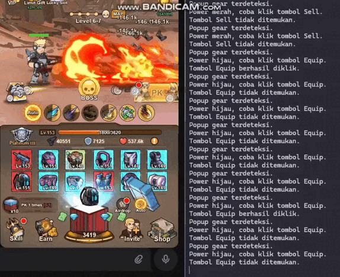

<div align="center">

<!-- ═══════════════════════════════════════════════════════════════════════ -->
<!--                    🎬 BOT IN ACTION - LIVE DEMO 🎬                      -->
<!-- ═══════════════════════════════════════════════════════════════════════ -->

<br/>

<picture>
  <source media="(prefers-color-scheme: dark)" srcset="https://capsule-render.vercel.app/api?type=waving&color=gradient&customColorList=6,11,20&height=200&section=header&text=🎮%20Bombie%20Bot%20Demo&fontSize=50&fontColor=fff&animation=twinkling&fontAlignY=35">
  <source media="(prefers-color-scheme: light)" srcset="https://capsule-render.vercel.app/api?type=waving&color=gradient&customColorList=6,11,20&height=200&section=header&text=🎮%20Bombie%20Bot%20Demo&fontSize=50&fontColor=fff&animation=twinkling&fontAlignY=35">
  
</picture>

<h2>
  
</h2>

<br/>

<!-- ═══════════════════════════════════════════════════════════════════════ -->
<!--                           MAIN GIF SHOWCASE                             -->
<!-- ═══════════════════════════════════════════════════════════════════════ -->

<table>
<tr>
<td>

<div align="center">
  
### 🎬 **SEE HOW THE BOT WORKS**



<br/><br/>

> **🎯 Full automation of Bombie bot tasks**  
> Watch as the bot intelligently completes tasks, opens chests, and collects rewards automatically

<br/>

<!-- Feature Badges -->
<p>
  
  
  
</p>

<p>
  
  
  
  
</p>

</div>

</td>
</tr>
</table>

<br/>


<br/><br/>

</div>

<h1 align="center">⚠️ Внимание | Warning ⚠️</h1>

<div align="center">

[](https://bitbucket.org/lbesson/ansi-colors)
[](https://shields.io/)
[](https://shields.io/)

</div>

<div align="center">
  
</div>

<br/>

<h2 align="center">🚫 Русский</h2>

<p align="center">
  <b>
    ❗ ВНИМАНИЕ. ОФИЦИАЛЬНАЯ ПОДДЕРЖКА ОСТАНОВЛЕНА. БОТ МОЖЕТ РАБОТАТЬ НЕ КОРРЕКТНО! ❗
  </b>
</p>

<div align="center">
  <picture>
    <source media="(prefers-color-scheme: dark)" srcset="https://raw.githubusercontent.com/Panda404NotFound/bombie_bot/output/github-contribution-grid-snake-dark.svg">
    <source media="(prefers-color-scheme: light)" srcset="https://raw.githubusercontent.com/Panda404NotFound/bombie_bot/output/github-contribution-grid-snake.svg">
  </picture>
</div>

---

<h2 align="center">🚫 English</h2>

<p align="center">
  <b>
    ❗ ATTENTION. OFFICIAL SUPPORT HAS BEEN DISCONTINUED. THE BOT MAY NOT FUNCTION CORRECTLY! ❗
  </b>
</p>

<div align="center">
  
</div>

<div align="center">
  
[](https://GitHub.com/Panda404NotFound/bombie_bot/stargazers/)
[](https://GitHub.com/Panda404NotFound/bombie_bot/network/)
[](https://GitHub.com/Panda404NotFound/bombie_bot/graphs/contributors/)
[](https://GitHub.com/Panda404NotFound/bombie_bot/issues/)

</div>

<div align="center">
  <br />
  <h2>🎉 ВАЖНОЕ ОБНОВЛЕНИЕ 🎉</h2>
  
  > ### 🚀 Релиз версии 2.0! 
  > [](#-реализовано-ver-20)
  >   <br />
  > Бот готов к использованию! Pre-release версия!
  > Следите за обновлениями для получения полного функционала.
  > 
  > [](#-исправлено)

  <br />
</div>

## 📋 Содержание
- [Установка](#-установка)
- [Основная логика](#-основная-логика)
- [Реализованные функции](#-реализовано-ver-20)
- [Обновления](#-обновления-и-версии)
- [Для контрибьюторов](#-для-контрибьюторов)
- [Недостатки](#-недостатки)
- [Будущие разработки](#-планы-и-будущие-разработки)
- [Контакты](#-контакты)

## 🛠 Установка

<details>
<summary>1. Устанавливаем cargo пакет для Rust</summary>

[](https://www.rust-lang.org/tools/install)

```bash
# Linux/MacOS/Windows:
curl --proto '=https' --tlsv1.2 -sSf https://sh.rustup.rs | sh
```
</details>

<details>
<summary>2. Устанавливаем python 3.10</summary>

```bash
# MacOS:
brew install python@3.10

# Linux:
sudo apt install python3.10

# Windows:
# Скачать с https://www.python.org/downloads/release/python-31010/
```
</details>

<details>
<summary>3. Скачиваем проект</summary>

```bash
git clone https://github.com/Panda404NotFound/bombie_bot.git
```
</details>

<details>
<summary>4. Запуск проекта</summary>

```bash
# Режим отладки:
RUST_LOG=debug cargo run

# Режим выпуска:
cargo run --release
cd target/release
./bombie_bot
```
</details>

## 🔄 Основная логика

<div align="center">
  
  ```mermaid
  graph TD
    A[Вход в Telegram сессию] --> B[Поиск бота]
    B --> C[Запуск ссылки на бота]
    C --> D[Вход в бота]
    D --> E[Выполнение действий]
  ```
  
</div>

## ✨ Реализовано (ver. 2.0)

- 🎭 Эмуляция устройства и браузера с помощью playwright
- 🐍 Локальный venv внутри python_env куда устанавливаются все зависимости включая playwright
- 🔄 Контроль версий, зависимостей и установки через rust py_modules/
- 🌐 Взаимодействие с браузером через pyo3 и python код внутри src/python/bombie/*
- 📦 Открытие сундуков, выбор силы и автоматическая покупка/продажа
- 🎯 Проверка "auto" кнопки и автоматическое нажатие в случае отсутствия
- ⚡ Обработка Daily Task заданий, сбор наград
- ⏱️ Эмуляция задержки и рандома в нажатиях
- 💻 Мультиплатформенность за счет cargo пакетника
- 🎁 Сбор всех ежедневных наград
- 🔓 Абьюз бага с бесплатными сундуками
- 🔄 Реализован цикл сбора наград и открытия сундуков
- 🎮 Дополнительная логика для сбора сундуков

## 📝 Обновления и Версии

<details>
<summary>Версия 2.0 (28.11.24)</summary>

### 🚀 Изменения
- 🎁 Сбор всех ежедневных наград
- 📦 Абьюз бага с бесплатными сундуками
- 🔄 Реализован цикл сбора наград и открытия сундуков
- 🎮 Дополнительная логика для сбора сундуков
- 🐛 Исправлены мелкие ошибки и баги
- ⚡ Улучшена логика работы бота
</details>

## 💻 Для Контрибьюторов

<details>
<summary>Структура проекта</summary>

### Входная точка
```python
# Инициализация и запуск логики WebApp
logger.info("Запуск основной логики действий бота")
webapp_logic = WebAppLogic(self.page)
logic_task = asyncio.create_task(webapp_logic.start_logic())
```

### 📁 Основные модули (src/python/bombie/*)
- `task_action.py` и `chest_action.py` - автоматизация действий бота
- `cordination_module.py` - координация и Canvas API
- `module_manager.py` - управление модулями
- `ocr_manager.py` и `cv_manager.py` - работа с нейросетями
- `templates/*` - шаблоны для нейросети
</details>

## ⚠️ Недостатки

- 🔧 Нет гибкого модульного взаимодействия с разными клиентами
- 🌐 Нет поддержки proxy
- 📝 Нет авторегистрации
- 🔨 "Молдованская" реализация входа в telethon клиента

## 🔮 Планы и Будущие Разработки

<table>
<tr>
<td>🔄 Автообновления через GitHub releases</td>
<td>🤖 Телеграм бот для контроля сессий</td>
</tr>
<tr>
<td>🎮 Полная реализация bombie автоматизаций</td>
<td>🎭 Полная эмуляция человеческого поведения</td>
</tr>
<tr>
<td>👥 Работа с несколькими сессиями</td>
<td>⚡ Многопоточность и паралелизация</td>
</tr>
<tr>
<td>🐳 Автоскрипты и контейнеризация</td>
<td>📈 CI/CD и масштабирование</td>
</tr>
</table>

## 🛠 Исправлено
> 🔧 Здесь указаны исправления и доработки
<details>
<summary>Версии исправлений</summary>

Исправления на 28.11.24:

ver. 2.0:
- Исправлены мелкие ошибки и баги 
- Улучшена логика работы бота 
- Баги с директориями Windows

Исправления на 26.11.24:

- Исправлены баги с Windows системами
- Исправлены баги с проверкой меню заданий (сейчас всегда проверяет, улучшим в ver. 2.0 для динамики)
- Добавлен эксперментальный headless режим запуска (не рекомендуется в production)

Исправления на 25.11.24:

ver. 1.2.1:

- Добавлена кросс-компиляция 
- Добавлена поддрежка Windows системных библиотек 
- Исправлены мелкие ошибки и добавлены улучшения

Исправления на 25.11.24:

ver. 1.2:
- Добавления обработка цветных изображений 
- Улучшено распознавание изменений для логики
- Улучшена логика взаимодействия с объектами

Исправления на 25.11.24:

ver. 1.1:

- 2FA авторизация с повторными попытками
- Проблемы с загрузкой OCR модели и SSL разрешениями
- Запуск Daily Task в первую очередь, потом сундуки
- Логические ошибки при проверке меню заданий
- Добавлена выбор записи логов и трейсинга
- Проверка не корректного определения силы сундука
- Удаление логов при первом запуске
</details>

## 📞 Контакты

<div align="center">
  
[](https://t.me/brahman_mev)
[](https://t.me/hidden_coding)

</div>
